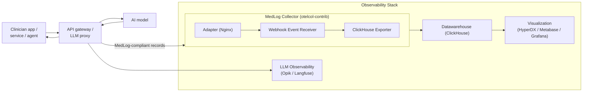

# MedLog OpenTelemetry Integration

This project demonstrates how to integrate MedLog event producers with an observability stack based on OpenTelemetry.

Optional semantic context supports OpenTelemetry GenAI, user/session attributes, FHIR
references, W3C PROV relationships, and OpenLineage references while preserving existing
event payloads. See the [semantic mappings and Weaver registry](docs/semantic-standards.md)
and the [FHIR R5 export guide and example](docs/fhir-export.md).

The stack uses the following components:

* MedLog event generator
* OpenTelemetry Collector
* ClickHouse for data storage and analytics
* HyperDX for dashboards and visualization

Whats

* LLM observability tooling such as Opik or Langfuse

# Architecture



See [DEBUG.md](DEBUG.md) for deployment failure modes and how to diagnose them.

# Configuration

Refer to the ClickStack and OpenTelemetry documentation for configuration details:

* [https://opentelemetry.io/docs/collector/configuration/](https://opentelemetry.io/docs/collector/configuration/)
* [https://opentelemetry.io/docs/collector/distributions/](https://opentelemetry.io/docs/collector/distributions/)
* [https://clickhouse.com/docs/clickstack/ingesting-data/collector#extending-collector-config-2](https://clickhouse.com/docs/clickstack/ingesting-data/collector#extending-collector-config-2)

# Instructions

## Clone the repository

This repo depends on the ClickStack repo, as such initialize them when cloning:

```bash
git clone --recurse-submodules <repository-url>
cd medlog-telemetry
```

Alternatively of you already cloned the repository without submodules, initialize them with:

```bash
git submodule update --init --recursive
```

The submodule also supplies `ClickStack/.env`, which defines the `HYPERDX_*` and image
tag variables that both compose files interpolate. If Compose warns that those variables
are not set and then fails with `no port specified: :<empty>`, the submodule is missing:
a GitHub ZIP download of this repository does not include submodule contents.

## Start the stack

Start the complete stack:

```bash
export MEDLOG_API_KEY=change-me
export MEDLOG_API_URL=http://localhost:5000
docker compose -f ClickStack/docker-compose.yml -f docker-compose.yml up -d --build
```

Wait for the receiver to accept requests before sending events:

```bash
until curl --silent --show-error --fail \
  -H "X-API-Key: $MEDLOG_API_KEY" \
  "$MEDLOG_API_URL/docs" >/dev/null; do
  sleep 2
done
```

## Offline install (no registry access)

Some hosts cannot pull the stack's images: air-gapped machines, or networks that
allowlist domains and silently drop `registry-1.docker.io` (DNS resolves, the TLS
handshake times out). `scripts/build_offline_bundle.sh` packages everything needed on a
machine that does have registry access:

```bash
scripts/build_offline_bundle.sh --full
```

It writes `dist/medlog-offline-linux-amd64.tar.gz` (plus a `.sha256`) containing:

| | |
|---|---|
| `images.tar` | every image the selected services need |
| `medlog-telemetry/` | the full source tree, including `ClickStack/.env` and the ClickHouse configs |
| `install.sh` | loads the images and starts the stack |
| `INSTALL.md` | the same steps, written out |

The source travels with the images deliberately: a GitHub ZIP download omits the
ClickStack submodule, and without its `.env` and `docker/clickhouse/local/*.xml` the
stack fails in ways that do not name their cause — `no port specified: :<empty>` for the
former, and a `ch-server` restart loop ending in an XML parse trace for the latter.

Images are pulled for the target platform, and `event-receiver` is built locally because
its Dockerfile runs `pip install` and so cannot be built on a host without PyPI access.
The script then verifies, by reading the image configs out of the archive, that every
image really is the requested platform. This is not redundant: when the local image store
already holds another architecture for a tag, `docker pull --platform` can leave that one
in place, and the mismatch would otherwise only surface after the bundle reached the
target host.

Omit `--full` to leave out HyperDX and Mongo. The bundle then holds only the ingest path
— `event-receiver` -> `medlog-otelcol` -> `ch-server` — which is what every test below
exercises; those two are the largest images and serve only the web UI. Use
`--platform linux/arm64` for an arm target (the default is `linux/amd64`).

On the target host:

```bash
tar xzf medlog-offline-linux-amd64.tar.gz
cd medlog-offline-linux-amd64
export MEDLOG_API_KEY=change-me
./install.sh
```

Everything below works unchanged, except *Run tests*, which needs PyPI to install the
receiver's dependencies.

## Test the event generator

Generate one authenticated synthetic run:

```bash
python3 scripts/generate_medlog_events.py --runs 1
```

Verify that events reached ClickHouse:

```bash
docker compose -f ClickStack/docker-compose.yml -f docker-compose.yml exec -T ch-server \
  clickhouse-client --query \
  "SELECT EventType, count() AS events, uniqExact(RunId) AS runs
   FROM medlog.medlog_events
   GROUP BY EventType
   ORDER BY EventType"

docker compose -f ClickStack/docker-compose.yml -f docker-compose.yml exec -T ch-server \
  clickhouse-client --query \
  "SELECT RunId, event_count, model_id, first_seen, last_seen
   FROM medlog.medlog_run_summary
   ORDER BY last_seen DESC
   LIMIT 1"
```

The first query shows the raw event rows. The second shows the newest derived
run summary. A one-run generation normally creates three or more events, so
the counts should increase after each run.

## Test MedLog LLM tool

Test `Medlog tool` itself with the smoke-test script. It exercises the same receiver and ClickHouse path:

```bash
run_id=$(python3 scripts/test_medlog_tool.py)
printf 'Medlog run: %s\n' "$run_id"
```

The smoke test should produce three events. Allow a few seconds for the
collector and materialized view to process them, then verify that exact run:

```bash
for attempt in $(seq 1 15); do
  event_count=$(docker compose -f ClickStack/docker-compose.yml -f docker-compose.yml \
    exec -T ch-server clickhouse-client --query \
    "SELECT count() FROM medlog.medlog_events WHERE RunId = '$run_id'")
  if [ "$event_count" -ge 3 ]; then
    break
  fi
  sleep 2
done

docker compose -f ClickStack/docker-compose.yml -f docker-compose.yml \
  exec -T ch-server clickhouse-client --query \
  "SELECT EventType, EventId, RunId
   FROM medlog.medlog_events
   WHERE RunId = '$run_id'
   ORDER BY Timestamp"

docker compose -f ClickStack/docker-compose.yml -f docker-compose.yml \
  exec -T ch-server clickhouse-client --query \
  "SELECT RunId, event_count, model_id, first_seen, last_seen
   FROM medlog.medlog_run_summary
   WHERE RunId = '$run_id'"
```

The raw event query should show `inference-start`, `internal-artifact`, and
`human-output`; the summary should show `event_count` equal to `3`.

## Export summary statistics

Aggregate ingest volume, per-run record completeness and storage footprint, printed and
written as CSV:

```bash
scripts/medlog_summary_stats.sh
```

Every query aggregates over metadata only — no prompts, outputs, target identifiers or
URIs are read — so the CSVs can be shared off a host that holds sensitive records. They
land in `output/medlog-stats/`, or wherever `--output-dir` points.

This needs only `ch-server`, so it is the way to get numbers off a host running the core
services without HyperDX (see *Offline install* above). `run_completeness.csv` is the
table worth reporting alongside run counts: outcome and feedback fragments arrive late or
never, and it gives the share of runs each one reached.

## Run the receiver locally

To run the event receiver outside Docker instead:

Keep the complete [schemas/ directory](schemas/README.md) alongside `event-receiver/`.
The receiver reads these contracts locally, independently of the working directory.
Use the source checkout and editable installation below; a standalone receiver wheel
does not bundle the schemas.

```bash
cd event-receiver
python3 -m venv .venv
.venv/bin/python -m pip install -e .
cp .env.example .env
# Set OTEL_EXPORTER_OTLP_ENDPOINT and MEDLOG_API_KEY in .env for your local environment.
.venv/bin/python app.py
```

In another terminal, export the same receiver settings and send synthetic events:

```bash
export MEDLOG_API_KEY=change-me
export MEDLOG_API_URL=http://localhost:5000
python3 scripts/generate_medlog_events.py --runs 1
```

## Run tests

Run the event-receiver tests:

```bash
event-receiver/.venv/bin/python -m unittest \
  discover -s event-receiver -p 'test_*.py'
```

## Stop the stack

Stop demo:

```bash
docker compose -f ClickStack/docker-compose.yml -f docker-compose.yml down
```

## Debug the collector

Debug `otelcol`:

```bash
docker compose -f ClickStack/docker-compose.yml -f docker-compose.yml run --rm --no-deps --entrypoint /bin/sh medlog-otelcol
```

# Considerations for a Production Deployment

* **Store raw events as received.** As a general principle, raw events should be retained in their original form. To support this, add an OpenTelemetry exporter that writes events to object storage such as MinIO or Amazon S3.
* **Introduce a message queue where appropriate.** To make events available to multiple consumers and provide buffering between producers and downstream systems, consider adding a message broker such as Apache Kafka as an intermediate layer.

For more information about ClickHouse and different OpenTelemetry integration strategies, see:

* [https://clickhouse.com/docs/guides/use-cases/observability/build-your-own/integrating-opentelemetry](https://clickhouse.com/docs/guides/use-cases/observability/build-your-own/integrating-opentelemetry)
